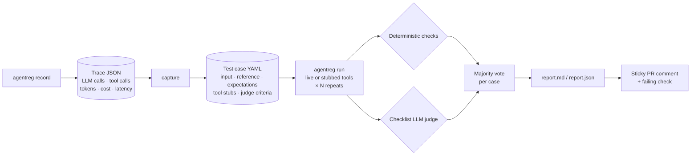

# 🧪 agentreg: regression tests for LLM agents

**Change a prompt, model or tool, and know exactly what broke before you merge.**

agentreg records real agent runs, turns them into editable test cases, replays them after every change, and flags regressions. It uses cheap deterministic checks (*did it call the right tools? did it stay within budget?*) plus an evidence-grounded LLM judge, then posts the result as a sticky comment on your pull request.


---

## Why

Unit tests don't fit agents. Their outputs change from run to run, a "small" prompt edit can silently stop a tool from being called, and a model swap can halve your bill or halve your quality. You only find out in production. agentreg brings the snapshot-testing workflow to agents:

1. **Record** a real run, so you capture what the agent actually does.
2. **Capture** it as a YAML test case with expectations derived from that run.
3. **Replay** every case on each pull request and get a verdict for each one: ✅ passed · ❌ regressed · ⚠️ flaky · ⬆️ improved.

## What a report looks like

This is a real report. A change to the demo agent's decision prompt ("keep reasoning generic, cite no numbers") kept the output format and every tool call intact. The deterministic checks therefore passed, but the judge flagged the drop in quality in all five cases:

| Case | Status | Tool calls vs reference | Tokens | Latency | Judge |
|---|---|---|---|---|---|
| agritech | ❌ regressed | unchanged (7 calls) | 1,870 → 1,658 (-11%) | 6.0s → 8.6s | worse (4/6 vs ref 6/6) |
| fitness | ❌ regressed | unchanged (7 calls) | 1,809 → 1,635 (-10%) | 6.4s → 4.9s | worse (4/6 vs ref 6/6) |
| … | | | | | |

> **Judge: worse**
> - ✅ Gives an explicit Go or No-Go decision for every idea it discusses.
> - ❌ Cites specific figures from the evidence, such as the market size, CAGR and risk scores. *The response does not cite specific figures such as market size, CAGR, or risk scores from the evidence.*
> - ❌ Names specific competitors, trends or legal risks taken from the evidence.
> - ✅ Makes no claims that contradict or go beyond the evidence.

On the unchanged agent, the same suite returns 5/5 ✅ with every case at 6/6 criteria.

## How it works



| Component | What it does |
|---|---|
| **Recorder** (`recorder.py`) | A LangChain callback handler, enabled through a context variable. Any LangChain or LangGraph agent is traced **with no code changes**: model, tokens, cost, latency, tool name, args and output. It's thread-safe, because LangGraph runs tools in parallel. |
| **Capture** (`capture.py`) | Trace → YAML case. Expectations are derived automatically: required tools, plus token, cost, step and latency budgets set to the recorded value × a tolerance. Edit the YAML to tighten them. |
| **Replay** (`replay.py`) | Runs each case N times. `--tools stub` serves the recorded tool outputs, so you test *your change* and not today's API responses. |
| **Checks** (`checks.py`) | A registry of pure functions: `required_tools`, `forbidden_tools`, `tool_order`, `tool_args` (regex), `max_tokens`, `max_cost_usd`, `max_latency_s`, `max_steps`, `output_contains`, `output_regex`, `no_tool_errors`. Add your own with `@check("name")`. |
| **Judge** (`judge.py`) | Grades each response against yes/no criteria, grounded in **its own run's tool results**, and compares the result with the reference's grades. |
| **Report + GitHub** (`report.py`, `github.py`) | Markdown and JSON reports. One PR comment, found by a hidden marker and edited on every push instead of duplicated. |

## Engineering decisions (and the data behind them)

**1. Majority vote across repeats.** Agents are nondeterministic. The *unchanged* demo agent skipped a required research tool in 4 of 40 runs. A single run would turn that into random red CI builds. With `--repeats 3`, a case only counts as regressed if it fails in most runs. Fewer failures than that mark it ⚠️ flaky instead, which doesn't block the merge unless you pass `--fail-on-flaky`.

**2. Stub replay, with misses reported.** Recorded tool outputs are matched by tool name and normalised args, so an omitted default and an explicit default count as equal. The stub wraps `BaseTool._run` with `functools.wraps`, which keeps the signature LangChain inspects, and it only activates inside a context variable. A tool call that has no recording runs live and is listed in the report as a new behaviour.

**3. The judge went from pairwise to checklist, because the data said so.** The first judge compared reference and candidate side by side, in both orders to cancel position bias. Measured on this agent, it picked *whichever response came first* in almost every comparison, and it scored the "cite no numbers" regression above as a tie. The replacement grades **one** response at a time against binary criteria:
- One response means there's no position to be biased about, and yes/no criteria are more stable than 1–10 scores.
- Each response is graded with the tool results from its own run as evidence. Agent runs legitimately differ in content: the demo agent invents new startup ideas every time, so comparing the content of two answers directly is meaningless.
- The verdict compares failures. A criterion the reference passed but the candidate fails makes it "worse", and the report names that criterion.
- Reference grades are cached by content hash, so a case costs about one judge call.

**4. References are snapshots.** `agentreg run --accept` makes the latest run the new reference, like updating snapshots in Jest, so an intended behaviour change is one command plus a reviewable YAML diff.

**5. Cost is a first-class metric.** Every run reports the agent's spend and the judge's spend separately. The full demo suite (5 cases × 3 repeats) costs about $0.17 per PR.

## What it caught in the demo agent

The demo target is [startupIdeaGenerator](https://github.com/JYOTSNACHOUDHARY/startupIdeaGenerator), a LangGraph agent that generates startup ideas, researches them with five tools, and gives Go / No-Go verdicts. A copy lives in [`examples/startup_validator`](examples/startup_validator).

| Finding | Evidence | Fix |
|---|---|---|
| The validator sometimes skipped research tools | `required_tools` failed in 4 of 40 runs (10%) | Prompt now requires every tool: **0 of 20** runs failed after the fix |
| The decision step only saw the *last* tool result | Verdicts cited one risk score and nothing else | It now reads every tool result from the research turn |
| A "be generic" prompt edit | Judge: 4/6 vs 6/6 criteria, in 5 of 5 cases | That's the regression the suite exists to catch |

## Quickstart

```bash
git clone https://github.com/JYOTSNACHOUDHARY/agent-regression-tester.git
cd agent-regression-tester
uv sync
export OPENAI_API_KEY=sk-...

uv run agentreg record "healthcare"           # run the agent once → traces/ + cases/
uv run agentreg run --tools stub --repeats 3  # replay everything; exit code 1 on regressions
open reports/report.md
```

Then try breaking it: remove `legal_risk_checker` from `examples/startup_validator/prompts/startup_validator.py` and run again.

## Configuration

`agentreg.yaml` points at any LangChain Runnable, compiled LangGraph graph, or plain function:

```yaml
target: orchestrator.graph:graph          # module:attribute
pythonpath: [examples/startup_validator]
input_key: user_input                     # "healthcare" -> {"user_input": "healthcare"}
output_path: messages[-1].content         # where the final answer lives
budget_tolerance: 1.5                     # tokens / cost / steps may grow 50%
latency_tolerance: 3.0
judge:
  model: openai:gpt-4.1-mini              # any init_chat_model id, e.g. anthropic:...
```

A captured test case (abridged):

```yaml
id: fitness
input: fitness
reference:
  output: |-
    **Idea**: Virtual Reality Fitness Classes
    **Decision**: No-Go
    ...
  tool_sequence: [market_size_estimator, competitor_finder, trend_finder, legal_risk_checker, ...]
  total_tokens: 1809
expect:
  required_tools: [competitor_finder, legal_risk_checker, market_size_estimator, risk_score_calculator, trend_finder]
  max_tokens: 2714
  output_regex: ['\*\*Decision\*\*:\s*(Go|No-Go)']
judge:
  criteria:
    - Gives an explicit Go or No-Go decision for every idea it discusses.
    - Cites specific figures from the evidence, such as the market size, CAGR and risk scores.
    - Makes no claims that contradict or go beyond the evidence (no invented figures or facts).
tool_stubs:
  - name: market_size_estimator
    args: {domain: fitness, mock: true}
    output: "Estimate market size and CAGR for domain -  fitness are: {'market_size': '$5B', 'cagr': '8%'}"
```

## CI

[`.github/workflows/agentreg.yml`](.github/workflows/agentreg.yml) runs on every PR that touches the agent, its cases or this tool. It replays the cases (stubbed tools, 3 repeats), posts or updates the PR comment, uploads the full report as an artifact, and fails the check on regressions. Add `OPENAI_API_KEY` as a repository secret. Pull requests from forks don't receive secrets, so the job only runs fully on branches in this repo.

## Project structure

```text
src/agentreg/
├── recorder.py   # LangChain callback → Trace (context-var hook, thread-safe)
├── stubs.py      # Replay recorded tool outputs (wraps BaseTool._run)
├── capture.py    # Trace → YAML test case
├── replay.py     # Repeats, majority vote, --accept
├── checks.py     # Deterministic check registry
├── judge.py      # Evidence-grounded checklist judge
├── report.py     # Markdown / JSON reports
├── github.py     # Sticky PR comment
├── pricing.py    # Token prices → cost (overridable)
└── cli.py        # record · capture · run · comment
tests/            # 23 tests: a scripted fake chat model drives a real LangGraph agent, no network
```

## Limitations and roadmap

- Recording covers anything built on LangChain or LangGraph. Agents that call provider SDKs directly would need a thin adapter.
- Upstream nondeterminism (here, newly generated ideas) means some tool calls can't be stubbed. They run live and are reported.
- Next: an OpenTelemetry/OpenInference trace importer, a judge-calibration command that measures agreement with human labels, and caching judge grades across CI runs.

---

<p align="center">Built by <a href="https://github.com/JYOTSNACHOUDHARY">Jyotsna Choudhary</a> · <a href="https://www.linkedin.com/in/jyotsna-c/">LinkedIn</a> · <a href="https://www.youtube.com/@LearnHiddenLayers">YouTube</a></p>
